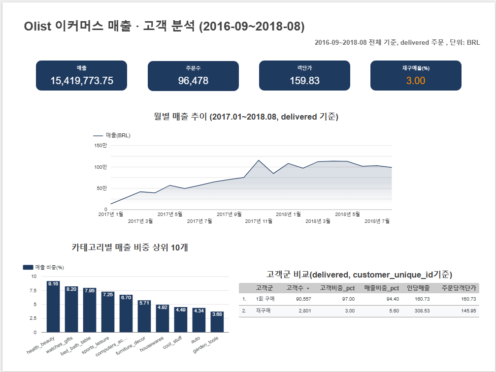

# olist-sql-analysis

# Olist 이커머스 매출·고객 분석 (MySQL + Data Studio)

브라질 이커머스 공개 데이터(Olist)를 MySQL에 적재하고, SQL로 매출, 재구매, 카테고리를 집계해 대시보드로 정리한 프로젝트입니다.

## 분석 질문
1. 월 매출은 어떻게 변했는가
2. 재구매 고객은 얼마나 되고 매출에 얼마나 기여하는가
3. 어떤 카테고리가 매출을 만드는가

## 데이터와 정의
- 출처: Kaggle Olist Brazilian E-Commerce (6개 테이블 적재: customers, orders, order_items, order_payments, products, category_translation)
- 대상은 delivered 주문, 고객은 customer_unique_id 기준
- 매출 = 상품 금액 + 배송비. 결제 금액 합계와 0.018% 차이
- 고객군: 1회 구매 / 재구매(2건 이상)
- 분석 구간: 2016-09 ~ 2018-08 (월별 차트는 2017-01부터)
- 금액 단위: 브라질 헤알(BRL). Kaggle 설명의 마켓플레이스 예시 화면이 R$로 표기돼 있어 이를 근거로 함

## 핵심 결과
- 월 매출은 2017-01(127,482.37)에서 2017-11(1,153,364.20)까지 약 9배 늘었고, 2018-03 이후에는 월 약 98.5만~113.3만 범위에서 움직입니다.
- 재구매 고객은 2,801명(3.00%)이고 매출의 5.60%를 차지합니다. 재구매 고객의 91.9%는 두 번째 구매에서 멈춥니다.
- 재구매 군의 인당 매출(308.53)은 1회 구매 군(160.73)의 1.92배이고, 주문당 객단가는 145.95로 9.2% 낮습니다.
- 매출 1위 카테고리 비중은 9.16%이고, 상위 5개가 39.25%, 상위 10개가 62.38%입니다.

## 대시보드

## SQL 파일
| 파일 | 내용 |
|---|---|
| 01~09 | 테이블 생성·적재 |
| 10 | 월별 매출 |
| 11 | 구매 빈도 분포 |
| 12 | 고객군 비교 |
| 13 | 카테고리 기여도 |
| 99 | 검산 쿼리 |

07번은 적재 후 따로 저장하지 않아 다시 쓴 기록용 쿼리입니다.

## 한계
- 재구매율은 관측 기간의 영향을 받습니다. 코호트로 검증하지 않았습니다.
- 주문 단위로 상품 금액과 결제 금액이 다른 569건의 원인은 확인하지 못했습니다(합계 영향 0.018%).
- 재구매 군의 카테고리 구성은 분석하지 않았습니다.
- 대시보드 공유 링크 권한 문제로 이미지로 대체했습니다.
